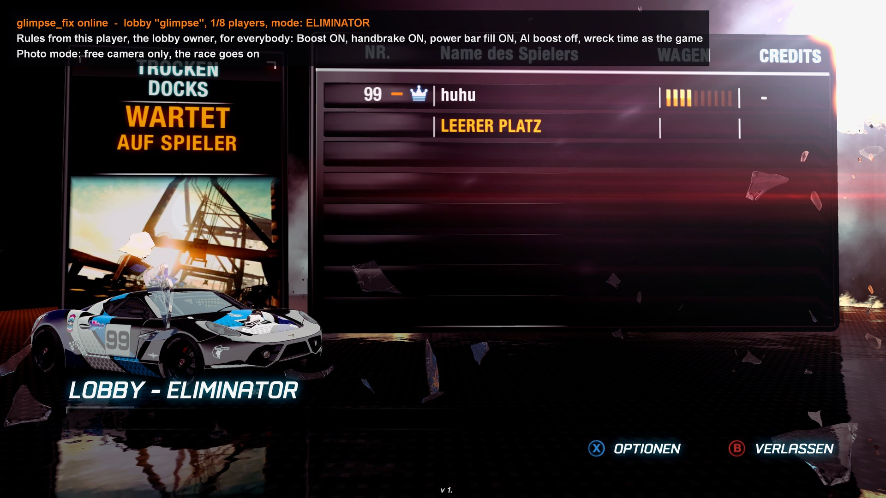

# glimpse_fix — Split/Second PC fix

A drop-in `dinput8.dll` for the **Steam** PC version of **Split/Second** (Disney / Black Rock, 2010)
that adds what the port never had, with a settings program instead of hand-editing an INI.

> **Compatibility: Steam version only.** Developed and tested exclusively with the Steam release
> (`SplitSecond.exe` 1.0.0.1, app 297860) on Windows 11. The retail DVD version
> (Split/Second: Velocity) and any other release have **not** been tested. Packs that replace the
> exe are not supported, see [Copy protection](#copy-protection). Which Steam language builds are
> supported is listed in [the technical notes](docs/TECHNICAL.md#supported-executables).

## Features

**Fixes**

* **Controllers:** every XInput pad (Xbox 360/One/Series, 8BitDo, Steam Input, DS4Windows, ...) works
  with the console layout, full menu navigation (a held D-pad keeps scrolling, as the stick does),
  Xbox or PlayStation button prompts, separate analog triggers and rumble. Out of the box the port
  only knows the wired Xbox 360 pad.
* **60 fps** with the simulation stepped exactly as at 30 fps, so physics and AI behave as intended.
* **Sharp, complete worlds:** a larger streaming pool against blurry, grey or missing textures and
  props, no pop-in of buildings beside the track, longer draw distances, sun shadows that reach twice
  as far and are drawn into a shadow map of twice the resolution, and the opponents' cars in the Xbox
  360's detail instead of the PS3's, so they no longer pop between detail levels.
* **Image:** anti-aliasing (SMAA) on the 3D picture with a sharp HUD, power play icons at console
  size at high resolutions, motion blur matched to 60 fps, anisotropic filtering, no stray line at
  the bottom at Very High, vignette, gradient, bloom and flares switchable.
* **Car glass as on the Xbox 360:** no sun shine on the windows from the surface behind them (DLC cars' white window frames).
* **Sound as on the console:** the opponents' engines are audible again, and the Xbox 360 release's
  reverb presets replace the PC's stock ones (see [Credits](#credits)).
* **Ultrawide:** the race cameras keep the 16:9 picture height; an experimental full mode widens
  every camera and keeps menus and HUD at 16:9 in the centre.
* **HDR output** for HDR displays: the game's picture at an adjustable paper white, and the highlights
  of the game's own HDR image (sun, sky, lights, explosions) up to the display's peak brightness.
* **Skippable cutscenes:** the season's "Coming up" and "Next time" movies, the end sequence, the demo
  and boot movies. The first press of A, B, X, Y, Start, Enter or Space shows "Press again to skip".

**Extras** (all off by default)

| | |
|---|---|
| **Boost** | Hold X (keyboard: left Shift) and your car surges forward, up to 324 km/h, with the motion blur swelling with it. |
| **Handbrake** | The game has none. Hold Y (keyboard: X) and the car brakes and swings into a slide with the steering, donuts included. |
| **AI boost** *(experimental)* | The AI boosts too, from easy to hard, or in **chaos mode** all the time with a full power play bar. |
| **Full power play bar** | LS + RS (keyboard: left Ctrl) fills it: drop a building on the leader whenever you like. |
| **Everything unlocked** | All tracks, events, episodes, modes and cars, through the game's own switches; your profile is not changed. |
| **Bonus content** | The PC version's cheat code extras: the Expressway track, the Cobretti SlipStream, the branded cars, the Euro livery. |
| **Achievements and decals** | All of them, or only the ones nobody can earn any more (ranked online, Pure). |
| **Camera** | Field of view, zoom keys, less camera shake, a HUD key and a **photo mode** with a free camera, depth of field, bloom and exposure. |
| **Skip the intro** | No boot movies at start. |
| **Potato presets** | For very weak PCs, at 60 fps: graphics quality Low, no shadows, no effects, the shortest draw distances; *Peeled potato* also draws the textures at an eighth of their size. See [Settings](#settings). |
| **Online over Steam** *(experimental)* | The game's LAN mode over the internet with the players of a Steam lobby: no server, no ports to open. See [Online over Steam](#online-over-steam-experimental). |
| **Texture dump** | All the game's textures as DDS files, the groundwork for texture packs. See [Texture dump](#texture-dump). |
| **DLC track Quarry** *(experimental)* | Your own converted Xbox DLC track Quarry in quick play, single player and split screen (`[DLC] Tracks=1`, see [INI.md](docs/INI.md)). |
| **Your own Xbox DLC** *(experimental)* | The settings program converts your own Xbox 360 DLC dump (cars, the Deadline mode, Quarry) on your PC and installs it; no DLC data comes with glimpse_fix. See [Your own Xbox DLC](#your-own-xbox-dlc-experimental). |

All buttons and keys can be changed. Details on every feature are in the
[technical notes](docs/TECHNICAL.md).

## Install

1. Copy `dinput8.dll`, `SplitSecondPad.ini` and `glimpse_config.exe` into the game folder
   (`...\steamapps\common\SplitSecond`).
2. Drag `SplitSecond.exe` onto `setlaa.exe`. It sets the large address aware flag, which the bigger
   streaming pool (and later texture packs) needs. The original stays as `SplitSecond.exe.orig`.
   Steam's "Verify integrity of game files" restores the original exe; just run it again.
3. Run `glimpse_config.exe` to change the settings.

Uninstall: delete the three files and rename `SplitSecond.exe.orig` back.

## Online over Steam (experimental)

The game's own LAN mode, played over the internet with the players of a Steam lobby: no server, no
sign-up, no ports to open. Steam carries the data, directly or through its relays. **This is new and
needs testing: please try it and report what you find in the
[issues](https://github.com/frankyfife/glimpse_fix/issues), with `SplitSecondPad.log` (`Log=1`) from
every PC involved.**

> **Important: online play needs one file that is NOT in the download.** Copying the fix is not
> enough: put `steam_api.dll` (32 bit) next to `SplitSecond.exe` yourself. It comes with Valve's
> Steamworks SDK (free download after signing in at partner.steamgames.com), file
> `sdk/redistributable_bin/steam_api.dll` (not the 64 bit `steam_api64.dll`). Without it the game runs
> as before, but online play stays off, and with `SteamLAN=1` and `Log=1` the log says that
> `steam_api.dll` was not found. With `SteamLAN=0` the file is not looked for at all.

**What you need**

* **`steam_api.dll` next to `SplitSecond.exe`** (see above).
* `SteamLAN=1` (settings program, page *Online*) on every PC, all with the same version of the fix.
* The game started through Steam.

**Where you land** when the game starts

| Setting | You meet |
|---|---|
| Lobby name empty | everybody else with an empty name, in the public lobby "glimpse" |
| A lobby name | everybody with the same name (letters, digits, `-` and `_`); Steam friends of a member can still join through "Join game" |
| *Friends only* | your Steam friends: you join a friend's lobby if one is playing, otherwise you open one that only your friends can find |
| Steam's "Join game" on a friend | that friend's lobby, also when your game is not running yet |

Two players who open a lobby of the same name at the same moment end up together in the older one
within 15 seconds. A full lobby (8 players) makes the next player open a second one.

**Playing**

* In the game choose *LAN*, then create a game or search for one. Several games can run in one lobby.
* The player who creates a game is its host: the host's mode and track apply, and so do the host's
  settings for boost, handbrake, power bar fill, AI boost and respot time (`WreckTime`), for everyone
  in that game. A guest uses its own buttons and keys for them, also when it has them off itself; when
  the boost or handbrake button is Y, the game's camera change moves to D-pad down.
* A banner at the top left shows the lobby, the players (2/8), the game mode and whose rules apply.
  The photo mode is a free camera there; the race goes on. The lobby name and the mode are also in
  your Steam status, which your friends can see in your game info.

Online play runs on the German/English and on the Russian Steam version. **Not yet:** split screen
in an online game. Tested so far with two players, in Race and Eliminator.



## Settings

`glimpse_config.exe` edits `SplitSecondPad.ini` next to it: one page per topic and a help line for
the option under the mouse. Every change is saved at once; bloom and exposure apply while the game
runs, everything else at the next start. Comments and keys it does not know stay as they are. Every
key is described in the [INI reference](docs/INI.md).

The *Presets* page sets everything but the Online, DLC and Debug pages at once: *Recommended* (the
defaults), *Original game*, *Potato* and *Peeled potato* for very weak PCs, and *Chaos*. Before a
preset is applied, your own settings are kept, and *Back to your settings* puts them back. Presets
change only the INI: the potato presets cap the graphics quality while they are on, but the level
chosen in the game's own menu stays saved as it is.

## Texture dump

Settings program, page *Debug*: *Dump textures on the next start*. At the next start a small window
says "glimpse_fix: dumping the game's textures, please wait" while the fix reads the game's
archives, then the switch turns itself off and the game closes. Start it again to play.

* Result: the folder `glimpse_textures` in the game folder, one subfolder per archive, every texture
  as a DDS file with an `index.txt` (size, format, mip levels). On the Steam version: 551 textures,
  573 MB, in about 10 seconds.
* The archives keep only a hash of each file name, so the files are named by that key
  (`0A1B2C3D.dds`); the key is also what a texture pack will use to say which texture it replaces.
* Nothing in the game folder is changed apart from the new folder and the switch in the INI, and
  no game code is involved.

This is the first step towards texture packs: a pack needs the original textures to start from.
Loading replaced textures in the game is the next step and not part of this version. That is also
why the large address aware flag (`setlaa.exe`) stays: high-resolution textures need address space
on top of the 512 MB streaming pool.

## Your own Xbox DLC (experimental)

The Xbox 360 version of Split/Second had downloadable content the PC version never got: the Deadline
car pack with the Deadline game mode, the Onslaught pack with the track Quarry, and more. If you
bought it on your Xbox 360, glimpse_fix can convert **your own copy** on your PC so the PC game loads
it. **No DLC content is part of glimpse_fix or downloaded by it**: without your own dump there is
nothing to convert, and the converted files stay on your PC. Please do not share them.

**Compatibility:** the Steam version 1.0.0.1 (German and English depots), not the Russian depot; on any
other executable the fix leaves the converted DLC off. The Russian depot is left out on purpose: the DLC
part relies on game addresses that are only worked out for the Steam build. All other features of the
fix work there as before. Support for the Russian depot may follow later, depending on how the beta
tests go.

Converted so far, from whichever of these packages your dump has:

* *Deadline*: Cobretti Centaur, Ryback Javelin, Ryback Coyote Special, Hanzo Kanobo, and the game mode
  Deadline (a countdown time trial) in quick play, with its time pickups (the Xbox's hexagonal token
  model, from your own DLC) and its own icon in the game mode instructions before the race;
* *High Octane*: Ryback Cyclone Special, Cobretti Severus, Ryback Vulcan, Hanzo Katana;
* *The Elite* livery pack: Elite 440 BRN, Elite S510 RP, Elite S510 VX;
* *Onslaught*: the track Quarry in quick play;
* *Survival At The Rock*: the nemesis track nem_quarry (*Minepit Park*, track 16) for Survival, and the
  split-screen game mode Survival Race.

All cars go into one car pack. *Master Unlock* is not needed.

**Texts.** The DLC's official texts (the help lines of Deadline and Survival Race, the pickup message and hint in
the game's language, the car descriptions, the rivals' names) are not in the DLC packages: the Xbox's Title
Update 4 carries them inside its program. A normal build therefore uses glimpse_fix's own texts, which explain the
same rules in other words. The official texts need a TU4 text table that the release cannot produce (it is made
with a local development tool that is not part of glimpse_fix); without it the converters write their own texts.

What you need:

* Your own DLC from the Xbox 360, copied off the console as it stores it: the folder `425607E7`
  (Split/Second's title ID) with the subfolder `00000002` and the package files in it (the long hex
  names, as the console keeps them in `Content\<profile>\425607E7\00000002`).
* About 4 GB free on drive C: for the conversion, 0.5 GB on the game's drive.
* The converters: the folder `glimpse_tools` of the release zip, copied into the game folder with
  `glimpse_config.exe` (from the source: `tools\dlc`; if they are somewhere else, the settings
  program asks for the folder the first time).
* These programs (glimpse_fix does not include or download them):

| Program | Used for | Without it |
|---|---|---|
| Python 3.8 or newer from python.org, with the *py launcher* (ticked by default in its installer) | runs the converters | nothing can be converted; the settings program says so |
| numpy (`py -3 -m pip install numpy`) | translating Quarry's Xbox shaders | Quarry is left out (state WARN), the cars and the mode are built |
| vgmstream-cli (the vgmstream project's command line tool for Windows) | decoding Quarry's sound banks (XMA on the Xbox) | Quarry is left out (WARN) |
| ffmpeg (a Windows build of FFmpeg) | encoding them for the PC | Quarry is left out (WARN) |
| `D3DCompiler_41.dll` (DirectX End-User Runtime, June 2010; the game's installer normally puts it in place) | compiling the translated Quarry shaders | Quarry is left out (WARN) |

vgmstream-cli and ffmpeg are found in `PATH`, in `glimpse_tools\bin` or in
`%LOCALAPPDATA%\glimpse_fix\tools`. `py -3 -I glimpse_tools\dlc\build_all.py --preflight --game <game
folder>` checks all of it without converting anything. The Havok class layouts the converters need
are read from your `SplitSecond.exe` during the build (about 15 seconds the first time).

In the settings program, page *DLC*:

1. *Xbox DLC folder*: pick the folder `425607E7` (or `00000002`).
2. *Build DLC*: converts everything on your PC (`tools\dlc\build_all.py`), about 10 minutes the first
   time, a minute or two after that, since finished steps are kept. The progress is shown below the
   buttons, *Open log* shows the details. The game folder is not touched: the result goes to
   `%LOCALAPPDATA%\glimpse_fix\dlc_staging`, the intermediate files to `...\dlc_work`.
3. *Install*: first shows what it would do, then copies your saves
   (`Documents\Disney Interactive Studios\Split Second` to `Split Second backup_<date>_dlc`) and
   copies the converted files into `glimpse_dlc` in the game folder. It only ever replaces or
   removes files it copied itself (it keeps a list, `glimpse_dlc\glimpse_dlc_installed.tsv`). Other
   archives in `glimpse_dlc` (for example from an older manual install) are named, and it offers to
   move them to `glimpse_dlc_replaced_<date>`, since the game would lay them over its data as well.
4. Turn on *Converted DLC*, *DLC tracks Quarry and Minepit Park* and, on the page *Deadline mode*, *Deadline game
   mode* (the program offers that after
   the install). *DLC cars in the car select without Unlock all* is on by default.
5. *Uninstall* takes it out again the same way: it shows what it will do, copies your saves, removes
   the files Install copied and puts back what it moved aside.

Without the settings program, from a command prompt in `glimpse_tools\dlc` (`tools\dlc` in the source; details in
[tools/dlc/README_build.md](tools/dlc/README_build.md)):

```
py -3 -I build_all.py --dump "<...>\425607E7" --game "<...>\steamapps\common\SplitSecond"
py -3 -I install_dlc.py --game "<...>\steamapps\common\SplitSecond"            (dry run)
py -3 -I install_dlc.py --game "<...>\steamapps\common\SplitSecond" --apply
```

To take it out again: `install_dlc.py --game <...> --uninstall` (dry run, then `--apply`), or just turn
off *Converted DLC*.
All of this is experimental: online, every player needs the same converted track (see
`TracksOnline` in [INI.md](docs/INI.md)).

## Copy protection

The Steam executable is protected with SecuROM. **This project does not remove, bypass or weaken
it, and it does not change any game code.** SecuROM checks the game code at fixed times after launch;
a changed instruction makes the game hang minutes later, typically after the finish line. That is
also the likely reason why earlier 60 fps patches got a reputation for breaking the game. glimpse_fix
works only through the game's data, swapped function pointers and calls into the game's own
functions, after checking the expected bytes, and through hooks in Direct3D, which is part of
Windows. The copy protection stays intact. How, in detail:
[Copy protection in detail](docs/TECHNICAL.md#copy-protection-in-detail).

**The "elysium" Xbox content pack (`Xenon.dll`) is not supported.** It replaces `SplitSecond.exe`
with the patched executable of the free PC demo and patches game code in memory, so the full game's
executable and its SecuROM protection are not used at all. It also redistributes the paid Xbox 360
DLC, which is still sold on the Xbox Store, without a license. The SS Multiplayer mod depends on it.
glimpse_fix checks for the unmodified Steam exe and switches most of itself off on the demo exe.
Please reproduce problems without such packs before reporting them.
[More on the pack](docs/TECHNICAL.md#the-xbox-content-modpack-xenondll-in-detail).

## Known limitations

* 60 fps: races, AI and physics were checked; not every power play and cutscene was. Set
  `FrameRate=30` if something looks off.
* Boost, handbrake, power bar fill, photo mode and HUD key work for player 1 only; the photo mode
  only on a single screen.
* Photo mode on crashes: once your car is wrecked, the game's crash sequence decides the view. Enter
  the photo mode before the crash for a free camera.
* The full ultrawide mode is experimental; split screen and the online menus are not checked yet.
* HDR runs the game in a borderless window instead of exclusive fullscreen; the Steam overlay may not
  show while it is on. A white HUD element over an already white sky is brightened with it.
* With a wheel or another DirectInput device present, the controls screen names inputs generically.
* `UnlockDecals` works in single player races; finish the race or leave it through the pause menu
  so the profile is saved.
* Online over Steam is experimental, see [above](#online-over-steam-experimental).
* On the Russian Steam build the options new in 2.2.0 are mapped and checked against a dump, not yet
  played. SMAA in split screen: the fix for [#15](https://github.com/frankyfife/glimpse_fix/issues/15)
  is in, not yet confirmed in the game.
* Audio: the game forces FMOD to DirectSound 5.1; the LFE channel and the pause menu are silent in
  the game's own mix.
* `TextureDetail` below full also blurs menu and HUD pictures that have mip levels; the text stays
  sharp. `ShadowResolution=4` is experimental.

Bug reports: set `Log=1` (settings program, *Debug*) and attach `SplitSecondPad.log`.

## Credits

* [Back on Air](https://github.com/xenophobentx/back-on-air) by xenophobentx gave the ideas for three
  features: the opponent engine fix (its notes pointed out that the opponents race without an engine
  sound on PC, which I had never noticed), the opponent car detail (the PC loads the PS3's car detail
  settings) and the longer shadow distance. All three were worked out and written independently
  here; no code was taken.
* MR-KOKOS: the full ultrawide mode (`UltrawideFix=2`).
* EndlessPapercuts: the request for skippable cutscenes
  ([#11](https://github.com/frankyfife/glimpse_fix/issues/11)).
* [SMAA](https://github.com/iryoku/smaa) by Jorge Jimenez, Jose I. Echevarria, Belen Masia, Fernando
  Navarro and Diego Gutierrez: the anti-aliasing shaders and tables, unchanged in `third_party/smaa`.

## Building

`build.bat` with the Visual Studio 2022 Build Tools (x86). The research tools and the address notes
are in the [technical notes](docs/TECHNICAL.md#building).

## AI disclosure

glimpse_fix is developed with AI assistance: the code, the reverse engineering and the
documentation are written with Claude (Anthropic). Changes are tested in the game on the
German/English Steam version before a release; what could not be tested is marked as such.

## License

GPL-3.0, see [LICENSE](LICENSE). `third_party/smaa` is under the MIT license
([its license](third_party/smaa/LICENSE.txt)). Split/Second is © Disney; this project contains no game
code or data.
